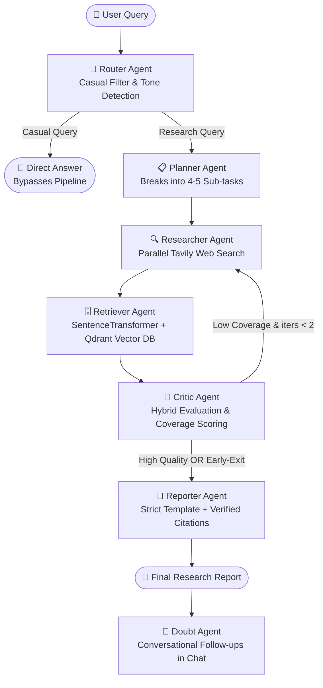

<div align="center">

  <h1>🤖 Multi-Agent AI — Research Assistant</h1>

  <p><strong>An autonomous, multi-agent AI research pipeline powered by LangGraph that plans, searches the live web, evaluates evidence, and synthesizes rigorously grounded reports with zero hallucinations.</strong></p>

  <br/>

  <!-- Badges -->
  <p>
    
    
    
    
    
    
    
  </p>

  <br/>

  [**✨ Features**](#-features) • [**💻 Local Laptop Setup**](#-how-to-run-locally-on-your-laptop) • [**🏗️ Architecture**](#️-multi-agent-architecture) • [**🐳 Docker Setup**](#-running-with-docker-compose) • [**🧪 Testing**](#-running-tests)

</div>

---

## 📸 Overview & ChatGPT-Style Interface

The project features a **ChatGPT-style web interface** that makes complex multi-agent workflows intuitive and conversational:

- **Conversational Experience**: Clean sidebar with past research history, prompt suggestions, and sticky bottom input bar.
- **Collapsible "Thinking" Process**: Watch all 6 agents (Router, Planner, Researcher, Retriever, Critic, Reporter) coordinate in real-time, inspect sub-tasks and evidence chunks, or collapse it for a clean reading view.
- **Streaming Report Output**: Tokens stream directly into the conversation via Server-Sent Events (SSE).
- **Interactive Numbered Citations**: Every claim is cited with bracketed numbers `[1]`, `[2]` linking straight to the verified source at the bottom.
- **Interactive Doubt Follow-ups**: Ask follow-up questions directly in the chat bar. The Doubt agent provides concise answers (<400 chars) and suggests next exploration steps.
- **One-Click Export**: Copy markdown to clipboard or download as `.md`.

---

## 💡 Features

| Component | Role & Technical Implementation |
| :--- | :--- |
| **🔀 Smart Router** | Intercepts casual queries (e.g. greetings) to answer immediately without wasting API calls. Analyzes question complexity and detects desired response tone. Powered by `gemini-2.5-flash`. |
| **📋 Dynamic Planner** | Decomposes questions into 4–5 targeted sub-tasks (history/fundamentals, direct metrics, current adoption, future outlook) with freshness-aware queries (e.g., current year 2026). Powered by `gemini-2.5-flash`. |
| **🔍 Parallel Researcher** | Fires concurrent Tavily searches across all sub-tasks in parallel via `ThreadPoolExecutor`. Gathers comprehensive passages without truncation. Powered by `Tavily API`. |
| **🗄️ Local Semantic RAG** | Chunks text into 300-token blocks, generates 384-dimensional embeddings via local SentenceTransformers (`all-MiniLM-L6-v2`), and performs targeted top-K retrieval in Qdrant with zero per-token embedding costs. |
| **🧐 Hybrid Critic & Early Exit** | Evaluates coverage across planned sub-tasks using hybrid scoring (30% LLM + 70% objective heuristics). Features **plateau detection**: if research coverage is solid (objective score $\ge 0.72$), it moves to reporting immediately, slashing query latency to **~25–35s**. |
| **📝 Grounded Reporter** | Synthesizes a structured report adhering strictly to a 6-part template (`Summary`, `Key findings`, `Details`, `Data / timeline`, `Gaps and caveats`, `Sources`). Runs deterministic number and citation audits to prevent hallucinated facts. Powered by Groq `openai/gpt-oss-120b`. |
| **🎯 Top 7–9 Deduplicated Sources** | Deduplicates passages by canonical URL, ranks sources by domain authority (`.gov`, `.edu`, peer-reviewed journals, verified news) and publication recency, and numbers them cleanly 1..N. |
| **⚡ SentenceTransformer Pre-Warming** | Background warm-up thread at API boot eliminates the ~80-second cold-load delay, ensuring fast execution from the very first request. |
| **🙋 Follow-up Doubt Agent** | Answers follow-up queries strictly against the generated report, returning crisp summaries and suggesting logical next steps. Powered by Groq. |

---

## 🏗️ Multi-Agent Architecture



---

## 💻 How to Run Locally on Your Laptop

Follow these step-by-step instructions to get the project running locally on your Windows, macOS, or Linux machine.

### Prerequisites

- **Python 3.11+** installed ([Download Python](https://www.python.org/downloads/))
- **Git** installed ([Download Git](https://git-scm.com/))
- **API Keys** (all have generous free tiers):
  - [Groq API Key](https://console.groq.com) (for Researcher, Critic, Reporter, Doubt)
  - [Google Gemini API Key](https://aistudio.google.com) (for Router and Planner)
  - [Tavily API Key](https://app.tavily.com) (for live web search)
  - *(Optional)* [Qdrant Cloud](https://cloud.qdrant.io) (if not using local in-memory Qdrant)

---

### Step 1: Clone the Repository

Open your terminal (PowerShell, Command Prompt, or Bash) and clone the repo:

```bash
git clone https://github.com/HariChandran7177-git/multi-agent-research-assistant.git
cd multi-agent-research-assistant
```

---

### Step 2: Create and Activate a Virtual Environment

#### On Windows (PowerShell):
```powershell
python -m venv .venv
.\.venv\Scripts\Activate.ps1
```
> *Tip: If PowerShell displays a script execution policy error, run:*
> `Set-ExecutionPolicy -ExecutionPolicy RemoteSigned -Scope CurrentUser`

#### On macOS / Linux:
```bash
python3 -m venv .venv
source .venv/bin/activate
```

---

### Step 3: Install Dependencies

Install all required Python packages:

```bash
pip install --upgrade pip
pip install -r requirements.txt
```

---

### Step 4: Configure Your Environment Variables

Create your `.env` file from the provided `.env.example`:

#### On Windows:
```powershell
copy .env.example .env
```

#### On macOS / Linux:
```bash
cp .env.example .env
```

Open `.env` in your text editor (VS Code, Notepad, etc.) and add your API keys:

```env
# Required AI Model Keys
GROQ_API_KEY=gsk_your_groq_api_key_here
GOOGLE_API_KEY=AIzaSy_your_gemini_api_key_here

# Required Live Search Key
TAVILY_API_KEY=tvly-your_tavily_api_key_here

# Vector Database (leave blank or omit to use fast local in-memory Qdrant automatically)
QDRANT_URL=
QDRANT_API_KEY=

# Local Storage Paths
DATA_DIR=./data
MODEL_CACHE_DIR=./model_cache
AGENT_TIMEOUT=120
```

---

### Step 5: Start the Local Web Application

Run the FastAPI backend server:

```bash
uvicorn api.research_api:app --reload --host 127.0.0.1 --port 8000
```

You will see the startup banner:
```text
INFO:     Started server process
INFO:     Pre-warming SentenceTransformer embedding model...
INFO:     SentenceTransformer pre-warm complete.
INFO:     Uvicorn running on http://127.0.0.1:8000 (Press CTRL+C to quit)
```

---

### Step 6: Open the ChatGPT-Style Web UI

Open your web browser and navigate to:

👉 **[http://localhost:8000](http://localhost:8000)**

You can now:
1. Click any of the prompt suggestions or type your own research query.
2. Watch the multi-agent progress card expand and coordinate live.
3. Read the streamed report with clickable citations `[1]`, `[2]`.
4. Ask follow-up questions directly in the chat bar!
5. Browse your past research history in the left sidebar.

---

### Step 7: (Alternative) Run Directly via Terminal CLI

If you prefer running research from your command line without the browser:

```bash
python main.py "Compare PostgreSQL pgvector vs Qdrant in 2026"
```

The CLI will display the live agent steps, print the final report, and offer an interactive follow-up doubt prompt.

---

## 🐳 Running with Docker Compose

If you have [Docker Desktop](https://www.docker.com/products/docker-desktop/) installed, you can spin up the full stack (including standalone Qdrant vector database) in one command:

```bash
docker compose up --build
```

- Web UI: **http://localhost:7860**
- Qdrant Dashboard: **http://localhost:6333/dashboard**

To stop the containers:
```bash
docker compose down
```

---

## 🧪 Running Tests

The repository includes test suites verifying citation grounding, template integrity, doubt conciseness, and API reliability:

```bash
# Run the accuracy and citation grounding suite
pytest tests/test_accuracy_and_grounding.py -v

# Run the complete test suite
pytest tests/ -v
```

---

## 📂 Project Structure

```text
multi-agent-research-assistant/
├── agents/
│   ├── router.py             # 🔀 Casual filter & tone detection (Gemini)
│   ├── planner.py            # 📋 4-5 targeted research sub-tasks (Gemini)
│   ├── researcher.py         # 🔍 Parallel Tavily live web search (Groq)
│   ├── retriever.py          # 🗄️ Local SentenceTransformer embeddings + Qdrant
│   ├── critic.py             # 🧐 Hybrid quality score & early-exit plateau check
│   ├── reporter.py           # 📝 Strict 6-part template report writer & source ranker
│   └── doubt.py              # 🙋 Crisp conversational follow-up answers (<400 chars)
├── api/
│   └── research_api.py       # FastAPI backend with SSE streaming, pre-warming, /reports
├── core/
│   ├── config.py             # Global constants, thresholds, and environment settings
│   ├── graph.py              # LangGraph StateGraph, conditional edges & checkpointing
│   ├── health.py             # Health check endpoints and service diagnostics
│   ├── logger.py             # Unified non-blocking structured console logging
│   ├── report_history.py     # SQLite persistence for past research reports
│   ├── scorer.py             # Objective quality heuristics (relevance, depth, sources)
│   └── state.py              # TypedDict ResearchState shared across all nodes
├── web/
│   ├── index.html            # ChatGPT-style web interface layout
│   ├── style.css             # ChatGPT design system (dark theme, responsive sidebar)
│   └── app.js                # SSE client, real-time message stream, history manager
├── tests/
│   ├── test_accuracy_and_grounding.py    # Grounding, citation, and doubt tests
│   └── test_production_readiness.py     # Architecture and container checks
├── main.py                   # Terminal CLI entry point
├── Dockerfile                # Production container specification
├── docker-compose.yml        # Docker compose specification with Qdrant service
├── requirements.txt          # Python library dependencies
└── README.md                 # Project documentation
```

---

## 📜 License

This project is licensed under the [MIT License](LICENSE).

<div align="center">
  <p>Built with ❤️ by <a href="https://github.com/HariChandran7177">Grandhi Hari Chandran</a></p>
</div>
